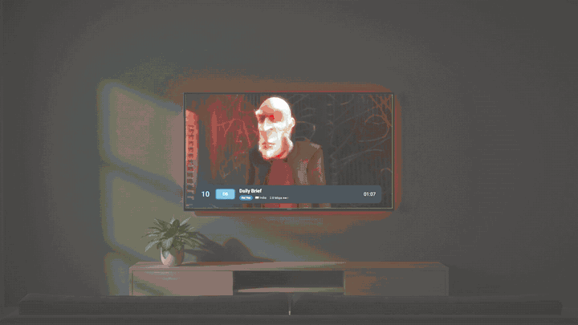

# Manus TV

A fast, remote-friendly live-TV app for Android TV / Google TV. You add your own M3U playlist links; Manus TV turns them into a clean channel guide you can drive with a TV remote: search, favourites, "For You" rows, quality choices, subtitles (translated to English on the device), and a hidden-dead-channels option.

[](https://iptv.appcloudpro.com/)

**▶ [Watch the 60-second video](https://iptv.appcloudpro.com/)** · **[Download the latest APK](https://github.com/WAOmaster/manus-tv/releases/latest)**

## Install on your TV
1. On your Android TV / Google TV, install the free **Downloader** app from Google Play.
2. Open it and type `iptv.appcloudpro.com/get`
3. Install, open Manus TV and add your playlist (type the link, or scan the QR code with your phone).

## What it is and is not
- It is a **player and guide**. It does not include, host or provide any channels, streams or programme data.
- You are responsible for the playlists you add. Only add playlists you have the right to use.
- No accounts, no ads, no analytics of our own. Your playlist links stay on your TV. (Google ML Kit, used for subtitle translation, sends anonymous diagnostics to Google; see the privacy policy.)
- Website: https://iptv.appcloudpro.com/ · [Privacy policy](https://iptv.appcloudpro.com/privacy.html) · [Support](https://iptv.appcloudpro.com/support.html)

## Features
- Add playlists by typing, or send the link from your phone (scan the QR code on the TV; same Wi-Fi).
- Many playlists merged; duplicates folded into one channel with several versions.
- Guide by country, category and playlist folder; search; favourites; recently watched; "For You" from your languages and countries (first-run setup).
- Pause and rewind live TV where the stream allows it; automatic reconnect and skip of dead streams.
- Subtitles: picks an English track, otherwise translates on the TV (Google ML Kit, models download once).
- Optional **channel data feed** (see below): hides dead channels and shows "now / next" programmes.
- Built with no Gradle: a small shell script (aapt2, javac, d8, apksigner). The app is about 8 MB.

## Two build flavours
| Flavour | For | First run |
|---|---|---|
| `FLAVOR=play` (default) | Store builds | No public list is mentioned or bundled. You add your own playlist link (type it or use the phone QR code) or skip. |
| `FLAVOR=full` | GitHub / sideload builds | Same, plus an opt-in "Add the free public list (iptv-org, community-maintained)" button. Add `DEFAULT_IPTVORG=1` to have it pre-enabled. |

## Build from source (Windows)
You need: **Git for Windows** (Git Bash), **JDK 17**, and the **Android SDK** with `platforms/android-36` and `build-tools/36.1.0` (install with Android Studio's SDK Manager or `sdkmanager`).

1. Clone this repo and open Git Bash in the folder.
2. Tell the build where the SDK is, for example: `export ANDROID_SDK=/c/Users/YOU/AppData/Local/Android/Sdk`
3. Run `bash build.sh`. The first run downloads Media3 and ML Kit (checked against pinned SHA-256 hashes). The result is `manus-tv.apk`.

Build options (environment variables, or put them in a git-ignored `local.env`; copy `local.env.example`):

| Variable | Meaning | Default |
|---|---|---|
| `FLAVOR` | `play` or `full` | `play` |
| `FEED_URL` | channel data feed address built in as the default | empty (none) |
| `DEFAULT_IPTVORG` | `1` = free iptv-org list pre-enabled (`full` only) | `0` |
| `ANDROID_SDK` | Android SDK folder | `%LOCALAPPDATA%/Android/Sdk` |
| `TARGET_SDK` | Android target version | 35 for `play`, 34 for `full` |
| `TV_IP` | your TV's address, used by `install.sh` and `tools/mirror.sh` | none |

Example: `FLAVOR=full FEED_URL=https://yourname.github.io/manus-iptv-data/ bash build.sh`

## Build for Google Play
Needs the same tools as above (JDK 17 for `bundletool`, which `tools/fetch-libs.sh` downloads and pins by SHA-256).

```
FLAVOR=play VERSION_CODE=2 VERSION_NAME=1.0.1 bash build.sh aab
```

Produces `manus-tv.aab` (signed with your **upload key**), plus `manus-tv.apk` and `manus-tv-universal.apk` (from the bundle, for checking), and runs `bundletool validate`. Play flavour: targetSdk 35, minSdk 26; `VERSION_CODE` must grow with every upload.

- **Upload key:** created on the first run at `~/.android/manus-iptv-upload.jks`, with a random password written to your git-ignored `local.env` (`UPLOAD_KS`, `UPLOAD_KS_PASS`, `UPLOAD_ALIAS`). Back up both; never commit them. Enrol in Play App Signing so Google holds the real signing key.
- **ABIs:** `armeabi-v7a` and `arm64-v8a` (ML Kit native libraries).
- **16 KB pages:** native libraries are stored uncompressed and page-aligned (`zipalign -P 16`); `tools/elfalign.py` checks each 64-bit `.so` has 16 KB ELF segment alignment. ML Kit's 32-bit libraries are 4 KB aligned, which Play allows (the rule covers 64-bit code).
- Play flavour only: Back from the top of the guide asks "Exit Manus TV?" so Back eventually reaches Home.

Tests: `bash tools/runtests.sh`.

## Install on your TV
1. On the TV: Settings > About, tap *Build* 7 times to enable developer options, then turn on *USB debugging* / *Wireless debugging* (ADB over network).
2. Put your TV's address in `local.env` as `TV_IP=...` (or `export TV_IP=...`), then run `bash install.sh`. It connects with adb, installs the APK and launches it.
   Or by hand: `adb connect <TV_IP>:5555` then `adb install -r manus-tv.apk`.

## Your own channel data feed (optional)
The app works fully without one. A feed adds "this channel is down", a popularity ranking and now/next programme titles.
The feed is just three small files on a web page, made daily by a GitHub Actions job. To run your own:

1. Open https://github.com/WAOmaster/manus-tv-data and press **Use this template** (create your own copy, public).
2. In your copy: **Settings > Pages > Source: GitHub Actions**, then **Actions > daily-data > Run workflow**.
3. When it finishes, your feed is at `https://<your-github-name>.github.io/<repo-name>/`.
4. On the TV: **Settings > About > Channel data feed**, type or send that address. The app checks it (`meta.json`) before saving. "Clear" turns it off again.

Builders can bake a default feed in with `FEED_URL`.

## Legal
Manus TV contains no channels, streams or programme data and does not host or provide any content. Streams you play come from playlists you choose to add; make sure you are allowed to watch them where you live. The optional public list and any data feed are third-party projects with their own terms.

Licence: Apache-2.0 (see [LICENSE](LICENSE) and [NOTICE](NOTICE)). Media3 is Apache-2.0, the QR library is MIT, ML Kit is under Google's terms; none of those binaries are stored in this repo (they are fetched when you build).

Contributing: see [CONTRIBUTING.md](CONTRIBUTING.md).
